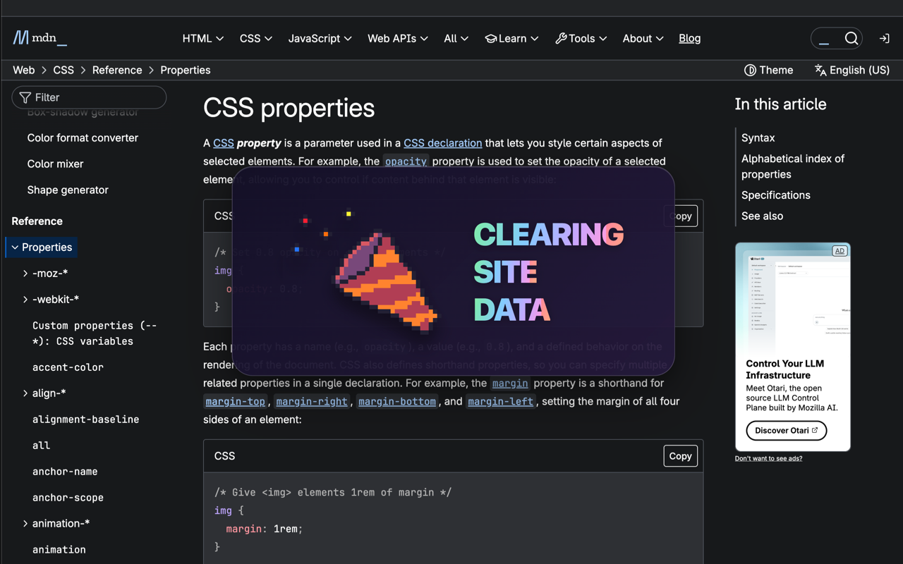
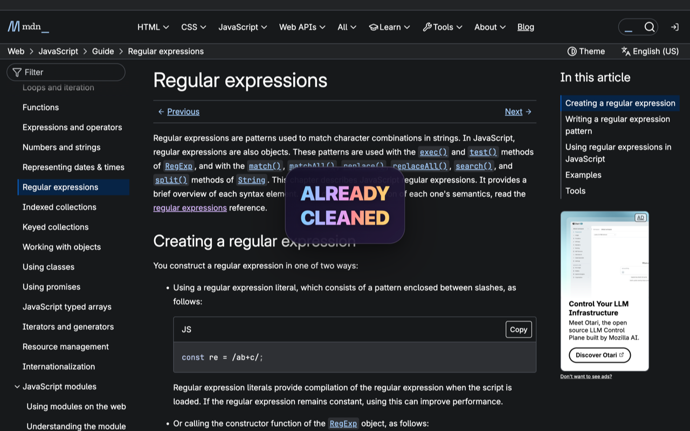

# SiteSweep

**Give the current website a fresh start with one click.**

SiteSweep is a Chrome extension that clears a website’s browser cache and stored data from a single toolbar button. Confetti, rainbow text, and a short bounce animation make cleanup easy to follow, right in the middle of the page.

## Features

- **One-click cleanup:** click the orange broom icon to clear data for the current website’s origin.
- **Animated feedback:** see a confetti animation while cleaning and a “Cache has been deleted” message after Chrome confirms completion.
- **10-second cooldown:** clicking again within ten seconds of a successful cleanup shows rainbow “Already cleaned” text without another cleanup or confetti.
- **Repeat-click feedback:** clicks during an active cleanup show “Cleanup in progress” instead of silently doing nothing.
- **No sidebar or account:** everything runs locally in Chrome.

## Screenshots

### Clearing website data

Confetti and rainbow text appear over the current webpage while SiteSweep clears its browser data.

### Already cleaned

During the ten-second cooldown, another click displays a short rainbow message without confetti.

## Install locally

1. Download or clone this repository. If you download a ZIP, extract it first.
2. Open `chrome://extensions` in Google Chrome.
3. Turn on **Developer mode**.
4. Click **Load unpacked** and select the folder containing `manifest.json`.
5. Open Chrome’s extensions menu (the puzzle-piece icon) and pin **SiteSweep**.

No build step, package installation, or server is required.

## Use SiteSweep

1. Open the website you want to clean.
2. Click the **SiteSweep broom** in Chrome’s toolbar.
3. Wait for the completion message. Chrome’s cleanup can take longer than the three-second visual feedback.

After cleanup finishes, the ten-second cooldown begins. Once it expires, the next click starts a fresh cleanup and replays the confetti. The cooldown is shared by tabs on the same website origin.

SiteSweep does not automatically reload the page. Reload it yourself when you want the website to load fresh content.

## What gets cleared

For the current origin—the combination of protocol, hostname, and port—SiteSweep requests removal of:

- Browser HTTP cache.
- Cache Storage.
- IndexedDB databases.
- Local storage.
- Service worker registrations.

**Clearing website storage can remove saved preferences, offline content, and locally saved work, and may sign you out of sites that keep login state in that storage.**

Cookies, browsing history, saved passwords, and session storage are not included in this cleanup. Server-side caches and databases are outside the extension’s scope.

“Already cleaned” reports a recent successful cleanup; it does not measure whether the website has created new cached data during the cooldown.

## Supported pages

SiteSweep handles regular HTTP and HTTPS websites. Chrome restricts script injection on internal pages such as `chrome://extensions` and other protected pages, so those pages cannot display its animations.

## Development

The extension uses Manifest V3 and plain JavaScript.

- `manifest.json` — extension metadata, permissions, toolbar icons, and bundled GIF access.
- `background.js` — toolbar clicks, site cleanup, cooldown handling, and page feedback.
- `assets/Confetti.gif` — bundled confetti animation.
- `icons/` — PNG extension icons and editable SVG artwork.
- `scripts/render-icons.swift` — macOS icon renderer.
- `docs/screenshots/` — images used in this README.

After editing extension files, save them and click SiteSweep’s **Reload** button at `chrome://extensions` before testing again.

## Artwork

Confetti animation: [pixel confetti on GIPHY](https://giphy.com/stickers/art-pixel-konfeti-DJ1GKM0YizJKpJP2tb).
